<a id="top"></a>

<div align="center">
  

  <br/>

  <a href="https://yonasgr.me"></a>
  <a href="https://yonasgr.me/yonasgr-resume.pdf"></a>
  <a href="mailto:yonasgirma222@gmail.com"></a>
  <a href="https://t.me/YonasGr"></a>
  <a href="https://x.com/YonasGgr"></a>

  <p>
    
    
    
    
  </p>

  <sub>
    <a href="#about">About</a> ·
    <a href="#now">Right now</a> ·
    <a href="#principles">How I build</a> ·
    <a href="#skills">Skills</a> ·
    <a href="#projects">Projects</a> ·
    <a href="#activity">Live activity</a> ·
    <a href="#stats">Stats</a> ·
    <a href="#contact">Contact</a>
  </sub>
</div>

<br/>

<a id="about"></a>


<div align="center">
  
</div>

<br/>

I'm a **software engineer and Information Technology student** from Ethiopia who likes turning messy, real-world problems into clean systems that people actually use. I build across the whole stack: **mobile apps** in React Native, **APIs** in FastAPI, **data layers** in PostgreSQL and Firebase, and the **Docker + CI/CD** plumbing that gets it all to production.

Much of what I make is shaped by the people around me: Telegram bots and mini apps people use every day, and an AI study companion built around daily habits. I like building tools that stay fast, reliable and easy to understand on any phone and any connection, which keeps me focused on **performance, resilience and simplicity**.

```ts
const yonas = {
  role: "Full Stack Software Engineer",
  studying: "Information Technology",
  stack: ["TypeScript", "Python", "React Native", "FastAPI", "PostgreSQL", "Docker", "Azure"],
  buildsFor: ["mobile", "telegram", "the web"],
  exploring: ["system architecture", "security", "networking"],
  motto: "Ship small, ship often, design for production on day one.",
  isOpenTo: ["collaborations", "interesting problems", "good conversations about code"],
} as const;
```

<div align="center"></div>

<a id="now"></a>
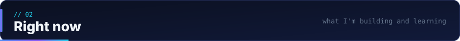

<table>
<tr>
<td width="33%" valign="top">

#### 🔨 Building
- **Logos Path:** shipping an AI-assisted Bible study app to Android & iOS
- **Safari Game Zone:** hardening multiplayer Bingo (fairness, wallets, scale)
- **Binance P2P Bot:** live ETB rates, charts and inline mode

</td>
<td width="33%" valign="top">

#### 📚 Learning
- Clean architecture & system design trade-offs
- Authentication, authorization & app security
- Networking fundamentals and protocols
- Azure services, containers and pipelines

</td>
<td width="33%" valign="top">

#### 🎯 Aiming for
- Designs that survive real production traffic
- Tests and observability as a default, not an afterthought
- More open-source, better docs
- Writing about what I learn along the way

</td>
</tr>
</table>

> [!TIP]
> Want to see how I think about a problem before we talk? The [portfolio](https://yonasgr.me) walks through the decisions behind each project, not just the screenshots.

<div align="center"></div>

<a id="principles"></a>
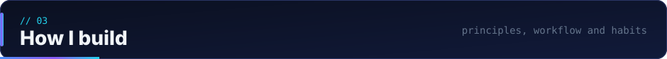

### 🧭 Engineering principles

| | Principle | What it means in practice |
|:-:|:--|:--|
| 🚢 | **Ship small, ship often** | Thin vertical slices, feature flags and quick feedback beat big-bang releases. |
| 🧱 | **Boring tech, sharp design** | Pick proven tools (Postgres, Docker, FastAPI) and spend the creativity on the problem. |
| 🔐 | **Never trust the client** | Validate and verify on the server: claims, prices, balances and permissions. |
| 🤖 | **Automate what repeats** | If I do it twice, it becomes a script, a Makefile target or a GitHub Action. |
| 📉 | **Design for bad networks** | Optimistic UI, retries, caching and graceful offline states, because users are on real networks. |
| 📖 | **Write it down** | READMEs, ADRs and clear commit messages: future-me is a teammate too. |

### 🔁 How an idea becomes a deployed feature

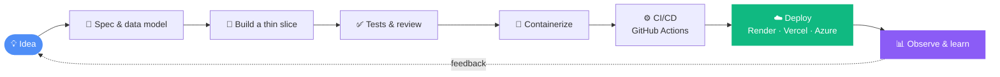

<details>
<summary><b>🧰 My default project checklist</b> (click to expand)</summary>

<br/>

- [x] Typed APIs with validated request and response models
- [x] Environment-based config, no secrets in the repo
- [x] Dockerfile + one-command local setup
- [x] CI that lints, tests and builds on every push
- [x] Clear README: what it is, how to run it, how it's designed
- [ ] Structured logging and error tracking *(always improving)*
- [ ] Load testing before launch *(on the roadmap)*

</details>

<div align="center"></div>

<a id="skills"></a>
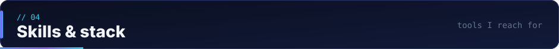

<div align="center">
  
</div>

<br/>

<div align="center">

| | |
|:--|:--|
| **Languages** |  |
| **Mobile & Frontend** |  |
| **Backend & APIs** |  |
| **Databases** |  |
| **Cloud & DevOps** |  |
| **Tools** |  |

</div>

<details>
<summary><b>🗺️ What I actually use each tool for</b></summary>

<br/>

| Tool | Where it shows up in my work |
|:--|:--|
| **React Native + Expo** | Cross-platform mobile apps, OTA updates, fast iteration on Android & iOS |
| **FastAPI + Python** | Typed REST/WebSocket backends, Telegram bots, background jobs |
| **TypeScript** | Mobile and web frontends, shared types, tooling |
| **PostgreSQL / Supabase** | Relational data, transactions for wallets & game state, auth and storage |
| **Firebase** | Auth, cloud sync, realtime data for mobile apps |
| **Docker** | Reproducible environments and deployable images |
| **GitHub Actions** | CI/CD, scheduled jobs, even this profile's live sections |
| **Render · Vercel · Azure** | Hosting APIs, web apps and cloud experiments |

</details>

<div align="center"></div>

<a id="projects"></a>
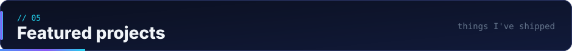

<div align="center">
  <a href="https://github.com/YonasGr/logospath">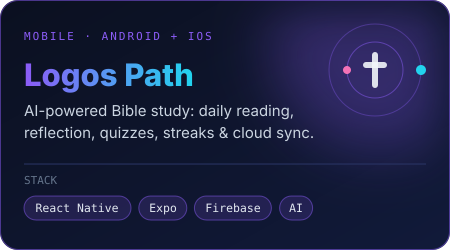</a>
  <a href="https://github.com/YonasGr/bingo">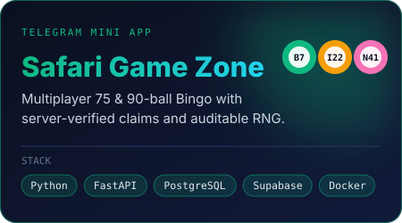</a>
  <a href="https://github.com/YonasGr/BinanceP2PtgBot">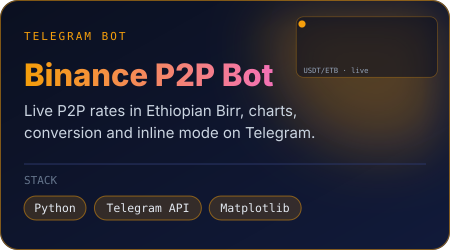</a>
</div>

<br/>

<details open>
<summary><b>🕊️ Logos Path</b> &nbsp;·&nbsp; AI-powered Bible study</summary>

<br/>

A cross-platform study companion that turns scripture reading into a daily habit: guided reading, AI-assisted theological reflection, quizzes, achievements, streaks and cloud sync across devices.

**Highlights**
- 📖 Daily reading flow with reflection prompts
- 🧠 AI-powered theological reflection via OpenRouter
- 🏆 Quizzes, achievements and streaks for retention
- ☁️ Firebase auth and cloud sync between devices
- 📱 One codebase for Android & iOS, plus a [web build](https://logospath-web.onrender.com)

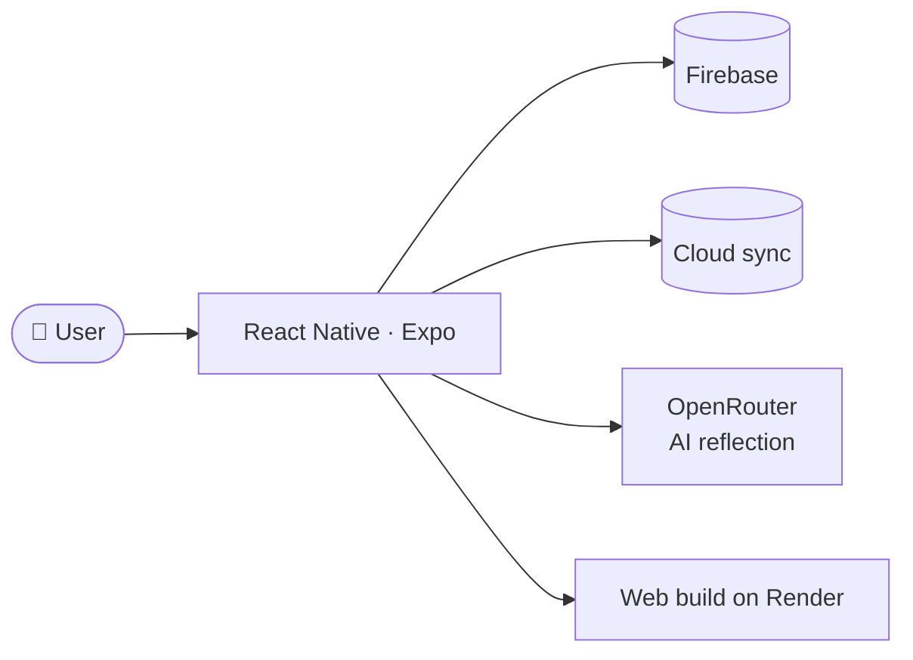

[🌐 Live demo](https://logospath-web.onrender.com) · [📦 Source code](https://github.com/YonasGr/logospath)

</details>

<details>
<summary><b>🎮 Safari Game Zone</b> &nbsp;·&nbsp; Multiplayer Bingo on Telegram</summary>

<br/>

A production-minded Bingo platform inside Telegram: 75-ball and 90-ball games, multiplayer rooms, a wallet system, and a design where the **server is the source of truth**.

**Highlights**
- 🎱 75-ball and 90-ball variants
- ✅ Server-verified win claims, so clients can't fake a Bingo
- 🎲 Auditable RNG for provable fairness
- 👥 Multiplayer rooms
- 💰 Wallet system for in-game balances

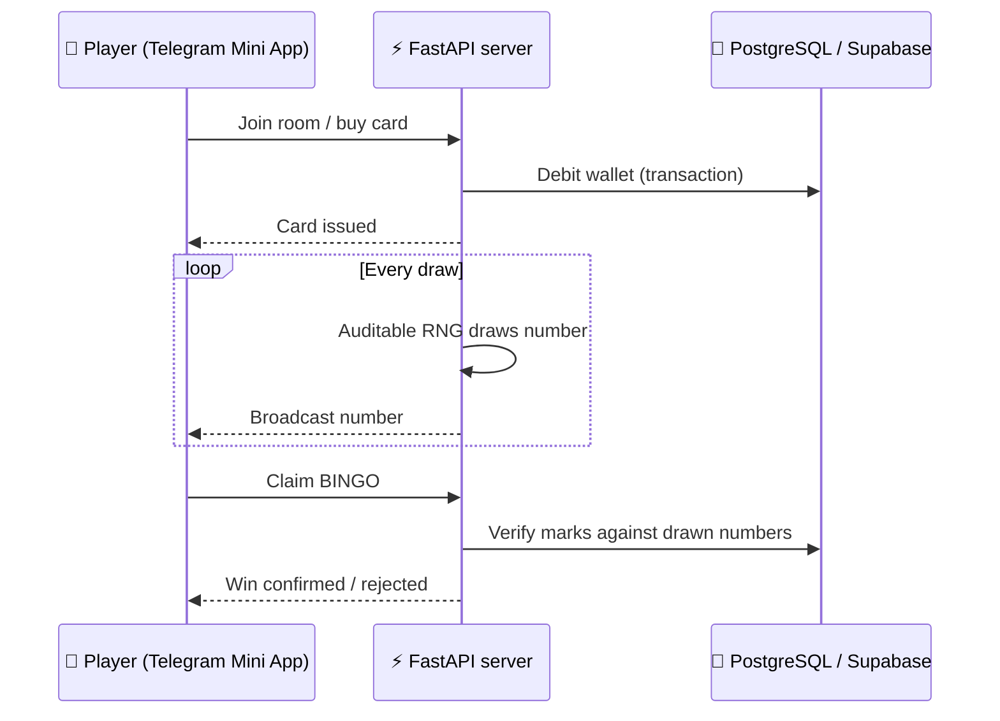

[📦 Source code](https://github.com/YonasGr/bingo)

</details>

<details>
<summary><b>💹 Binance P2P Bot</b> &nbsp;·&nbsp; Real-time crypto assistant</summary>

<br/>

A Telegram bot that answers a question every P2P trader in Ethiopia asks: *"what's the rate right now?"*

**Highlights**
- 📈 Live Binance P2P rates in Ethiopian Birr
- 🔄 Crypto conversion across multiple currencies
- 📊 Interactive charts rendered with Matplotlib
- ⌨️ Inline mode: query rates from any chat

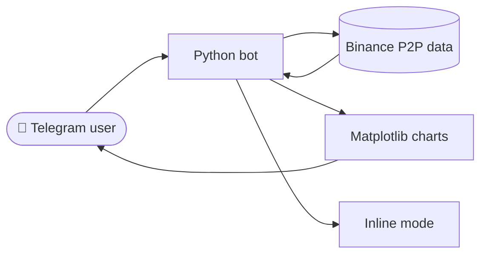

[🤖 Try the bot](https://t.me/binancep2pETBbot) · [📦 Source code](https://github.com/YonasGr/BinanceP2PtgBot)

</details>

> [!NOTE]
> The diagrams above are simplified overviews. Each repository's README goes deeper into architecture and setup.

<div align="center"></div>

<a id="activity"></a>
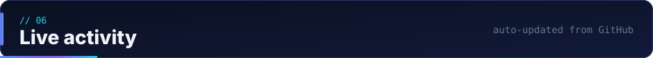

### 🆕 Latest repositories

<!--REPOS:START-->
| Repository | About | Lang | ⭐ | Updated |
|:--|:--|:--|:-:|:--|
| [**melbete-bingo**](https://github.com/YonasGr/melbete-bingo) | No description yet | 🐍 Python | 0 | 2h ago |
| [**portfolio**](https://github.com/YonasGr/portfolio) | Personal Portfolio | 📦 Astro | 1 | 3d ago |
| [**AMU-Resource-Management-System**](https://github.com/YonasGr/AMU-Resource-Management-System) | A modular university resource management system for Arba Minch Univer… | 🔷 TypeScript | 0 | 22d ago |
| [**Nochew-Store**](https://github.com/YonasGr/Nochew-Store) | 🚀 Full-featured Telegram Reseller Bot built with Python (aiogram 3) a… | 🐍 Python | 1 | 2mo ago |
| [**temesgen-rangobet**](https://github.com/YonasGr/temesgen-rangobet) | No description yet | 🟨 JavaScript | 0 | 3mo ago |
| [**Safari-Game-Zone**](https://github.com/YonasGr/Safari-Game-Zone) | No description yet | 🔷 TypeScript | 0 | 4mo ago |
<!--REPOS:END-->

### ⚡ Recent activity

<!--ACTIVITY:START-->
- ⬆️ Pushed **1** commit to [portfolio](https://github.com/YonasGr/portfolio) · <sub>3d ago</sub>
- 🔀 Merged a pull request in [portfolio](https://github.com/YonasGr/portfolio) · <sub>3d ago</sub>
- 🔀 Opened a pull request in [portfolio](https://github.com/YonasGr/portfolio) · <sub>3d ago</sub>
- ⬆️ Pushed **1** commit to [AMU-Resource-Management-System](https://github.com/YonasGr/AMU-Resource-Management-System) · <sub>22d ago</sub>
- 🔀 Closed a pull request in [AMU-Resource-Management-System](https://github.com/YonasGr/AMU-Resource-Management-System) · <sub>25d ago</sub>
- 🔀 Merged a pull request in [AMU-Resource-Management-System](https://github.com/YonasGr/AMU-Resource-Management-System) · <sub>22d ago</sub>
<!--ACTIVITY:END-->

<div align="right">
<!--UPDATED:START-->
<sub>🔄 Auto-refreshed on 10 Nov 2026, 20:08 UTC by GitHub Actions</sub>
<!--UPDATED:END-->
</div>

<div align="center"></div>

<a id="stats"></a>
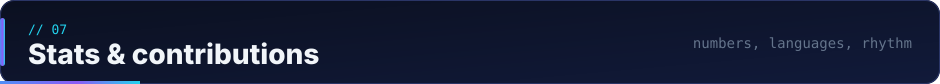

<div align="center">
  <picture>
    <source media="(prefers-color-scheme: dark)" srcset="./profile-summary-card-output/tokyonight/0-profile-details.svg">
    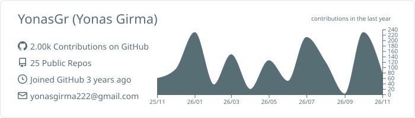
  </picture>
</div>

<table>
<tr>
<td width="50%">
  <picture>
    <source media="(prefers-color-scheme: dark)" srcset="./profile-summary-card-output/tokyonight/1-repos-per-language.svg">
    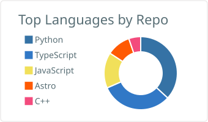
  </picture>
</td>
<td width="50%">
  <picture>
    <source media="(prefers-color-scheme: dark)" srcset="./profile-summary-card-output/tokyonight/2-most-commit-language.svg">
    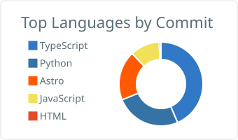
  </picture>
</td>
</tr>
<tr>
<td width="50%">
  <picture>
    <source media="(prefers-color-scheme: dark)" srcset="./profile-summary-card-output/tokyonight/3-stats.svg">
    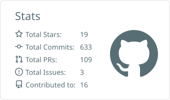
  </picture>
</td>
<td width="50%">
  <picture>
    <source media="(prefers-color-scheme: dark)" srcset="./profile-summary-card-output/tokyonight/4-productive-time.svg">
    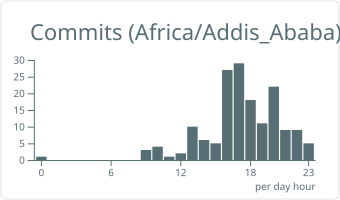
  </picture>
</td>
</tr>
</table>

<div align="center">
  <picture>
    <source media="(prefers-color-scheme: dark)" srcset="https://raw.githubusercontent.com/YonasGr/YonasGr/output/github-contribution-grid-snake-dark.svg">
    
  </picture>
</div>

<div align="center"></div>

<a id="contact"></a>
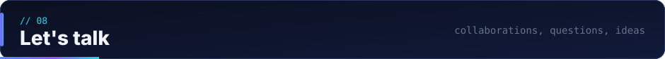

### 💬 Ask me about

<details>
<summary><b>📱 Shipping React Native + Expo apps</b></summary>

<br/>Project structure, state management, offline-first UX, OTA updates, store releases and the little details that make an app feel native.

</details>

<details>
<summary><b>⚡ Designing FastAPI backends</b></summary>

<br/>Typed schemas, async patterns, auth, background tasks, Postgres modelling and deploying with Docker.

</details>

<details>
<summary><b>🤖 Building Telegram bots & mini apps</b></summary>

<br/>Bot architecture, inline mode, mini-app auth, payments-adjacent flows and keeping server-side logic trustworthy.

</details>

<details>
<summary><b>🎓 Growing as a student engineer</b></summary>

<br/>Balancing studies with real projects, learning in public, and turning side projects into portfolio pieces.

</details>

### 🤝 Reach me

<div align="center">
  <a href="mailto:yonasgirma222@gmail.com"></a>
  <a href="https://t.me/YonasGr"></a>
  <a href="https://x.com/YonasGgr"></a>
  <a href="https://yonasgr.me"></a>
</div>

<br/>

<div align="center">
  
  <br/>
  <a href="#top"><sub>⬆ back to top</sub></a>
</div>
